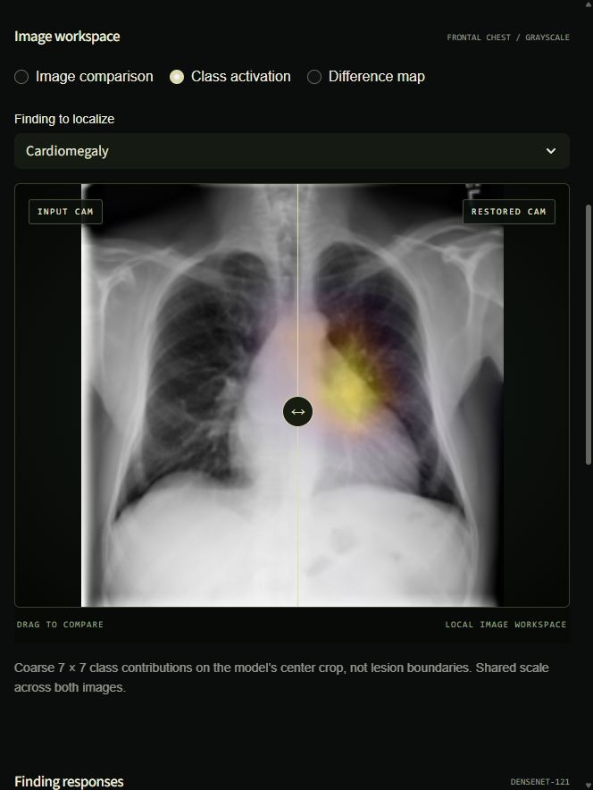

# VisionX Pro

**Chest X-ray restoration and explainable finding analysis.**



VisionX keeps the original chest radiograph visible, restores a second copy, and runs a frozen
DenseNet-121 on both. Inspect 18 finding scores, class activation maps, sensitivity to small
perturbations, and the effect of restoration on the model response. Image processing runs on the app server: locally on your computer, or on the provider when hosted.

This is a research prototype, not a clinical diagnostic or triage device. Scores are uncalibrated
model outputs, not disease probabilities. It does not claim clinical accuracy or COVID detection.

## Run locally

Python 3.12 is recommended. Create and activate a virtual environment, then run:

```text
python -m pip install -r requirements-clinical.txt
python setup_chest.py
python -m streamlit run app.py
```

Open http://127.0.0.1:8501. Choose a public sample, press **Analyze study**, then explore
**Class activation**, **Difference map**, and **Run sensitivity check**. Study controls opens
image selection, restoration method, resolution, device, and controlled noise experiments.

For neural restoration, download the separate upstream SwinIR model once:

```text
python download_models.py --model swinir_denoise
```

Non-local means is the fast default. SwinIR is optional and slower on CPU. Missing models produce
an actionable setup message; the app never substitutes synthetic scores. GPU requires a compatible
PyTorch installation. Weights stay local and are excluded from Git.

## What is implemented

- **Finding analysis:** frozen TorchXRayVision `densenet121-res224-all`, 18 outputs; original and
  restored scans are processed in the same batch. Raw sigmoid outputs are displayed, without
  upstream operating-point normalization or clinical decision thresholds.
- **Explainability:** exact class activation maps for the global-average-pooling/linear head.
  Signed CAM spatial means equal logits minus bias. Only positive contributions are visualized;
  the two maps share a display scale. Native 7 x 7 maps are not lesion segmentations.
- **Restoration:** NLM, SwinIR grayscale denoising, identity, CLAHE, and unsharp baselines.
- **Input:** PNG/JPEG/8-bit TIFF, plus single-frame uncompressed DX/CR grayscale DICOM.
  DICOM applies modality LUT, VOI LUT/window, valid-pixel normalization and MONOCHROME1 inversion.
  Unsupported modality, known lateral projection, non-chest body part and multi-frame inputs are rejected.
  Raster modality cannot be automatically verified; uploaded studies require user confirmation.
- **Paired research:** 3 Gaussian-noise levels x 3 seeds, always with an unprocessed baseline;
  SSIM/PSNR and drift from the reference model response. The supplied image is a reference,
  not necessarily a pristine scan. Single-image seed variation is not population uncertainty.
- **Sensitivity:** unchanged input, brightness +/-3%, and two independent noise perturbations
  at sigma 0.01. Score ranges are sensitivity measurements, not calibrated confidence intervals.
- **Evidence:** PDF, JSON, CSV and image export with preprocessing, timing, hashes and limitations.
- **Efficiency:** cached frozen models, bounded CPU threads, inference mode, batched classification,
  and CAM without additional backward passes. Interactive image comparison runs in the browser
  without rerunning inference. Uploaded-image results stay in session state, not a global cache.

## Model input and scope

Working images preserve aspect ratio. Classification then follows the upstream center-square crop,
224 x 224 resize and [-1024,1024] intensity normalization. The exact crop coordinates are exported;
peripheral anatomy may be excluded. The classifier supports chest radiographs only. No CT, MRI,
pediatric validation or COVID-specific classifier is provided. Generic SwinIR weights are not
medically fine-tuned. A cleaner image can change, suppress, or invent relevant-looking detail.

Two public NIH ChestX-ray14 examples are included with source URLs, transformation records and
SHA-256 hashes in assets/provenance.json. They may overlap model training data. They are demonstration
cases, not an independent test set. No accuracy, sensitivity, specificity or AUROC is inferred from them.

## Reproducibility and security

The old official XRV checkpoint is a serialized model. setup_chest.py verifies its fixed reviewed
SHA-256 before conversion and uses an explicit class allowlist. It converts the checkpoint into
plain state dictionaries. Runtime inference uses weights_only=True, strict loading and checksums.
The checksum pins these release bytes; it is not an independently published signature.

No external image upload or language-model-generated clinical narrative is used in the main app.
Identifying DICOM header fields and upload filenames are excluded from reports. Burned-in identifiers
may remain in pixels; exports are not guaranteed anonymized. Do not expose this local app as an
unauthenticated public patient-data service.

## Verify

```text
python -m pip install -r requirements-dev.txt
python -m pytest -q
python scripts/validate_chest.py
```

The unit suite runs without downloaded weights. The last command requires both chest and SwinIR
weights and saves real CPU inference examples in examples/chest-analysis. See VALIDATION.md.

The prior general image-restoration app remains available as `streamlit run restoration_app.py`,
including its optional Gemini quality-only review. The original restoration CLI is preserved.

## Research contribution and limitations

This project's contribution is the paired restoration/analysis workflow, evidence visualization,
reproducible stress experiments and exportable provenance. It does not introduce a new neural
architecture, train the pretrained weights, or establish medical-device efficacy.

The next defensible research step is patient-disjoint external evaluation with AUROC/AUPRC,
calibration, subgroup analysis, and expert review of detail preservation. Uncertainty calibration,
image-domain detection and clinical decision thresholds are not implemented.

## Sources

- TorchXRayVision: https://mlmed.org/torchxrayvision/ ; source commit 4f9c7753880a391273e051f3857bce5089dfade5
- Class activation mapping: https://arxiv.org/abs/1512.04150
- SwinIR: https://github.com/JingyunLiang/SwinIR
- Reconstruction instability: https://pmc.ncbi.nlm.nih.gov/articles/PMC7720232/

See THIRD_PARTY_NOTICES.md for attribution. The interface takes visual inspiration from reactor.inc
(near-black surfaces, ivory accents and large typography); no Reactor assets or branding are used.

## Streamlit Community Cloud

Deploy the existing repository, branch `main`, with entry point **`cloud/app.py`** and
Python **3.12** in Advanced settings. Community Cloud selects `cloud/requirements.txt`
next to that entry point; it includes the base dependencies and Linux CPU PyTorch wheels.
No API keys or secrets are required. Do not select the root `app.py` for this deployment.

The entry point downloads the hash-pinned upstream chest checkpoint, converts and verifies
it on first startup, and caches successful initialization across sessions. Sleep/restarts may
require another download. A failed setup displays a retry action instead of fabricated scores.

The hosted demo offers NLM and classical restoration, CPU analysis, and 224/256-pixel working
images. SwinIR/GPU remain available in the local app. Hosting memory and concurrency limits
still apply; multi-user load and provider memory limits have not been benchmarked.

Uploads are transmitted to the hosting server. The app keeps uploads/results in session memory
and does not intentionally save them to disk. This is a public research demo, not a clinical
service. Prefer the bundled public examples. Model weights are public and are the only items
downloaded automatically; user images are not sent to external inference APIs.
